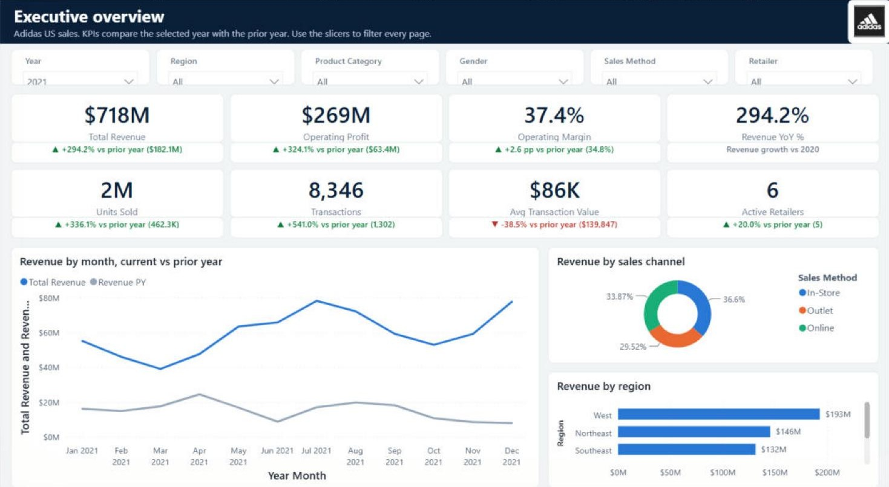
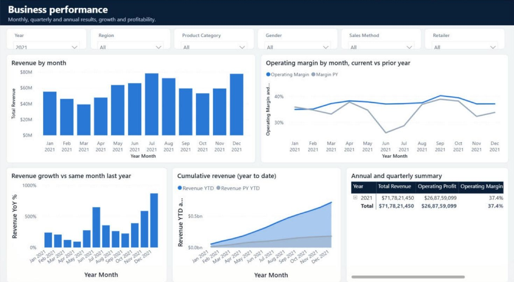
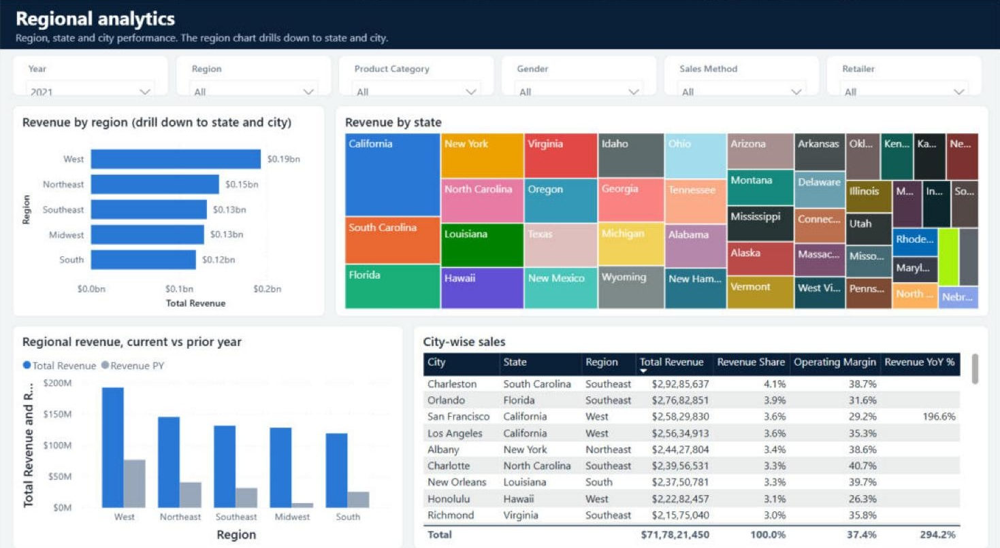
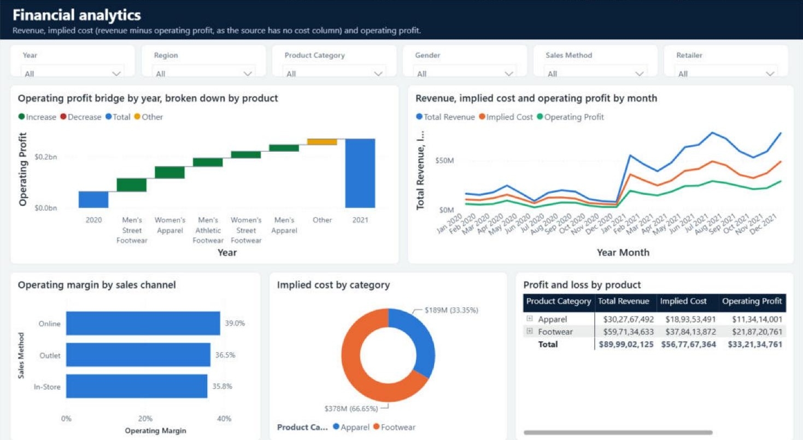
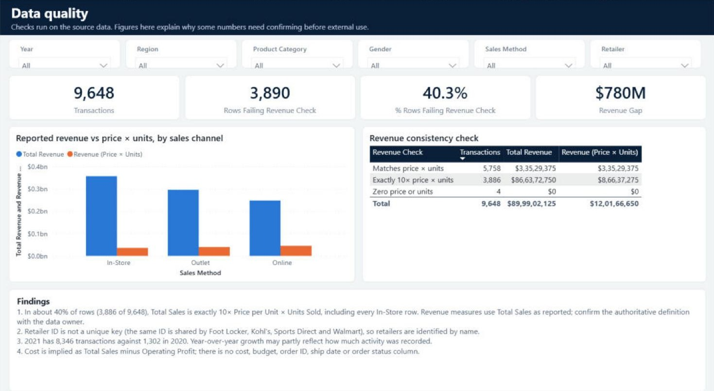
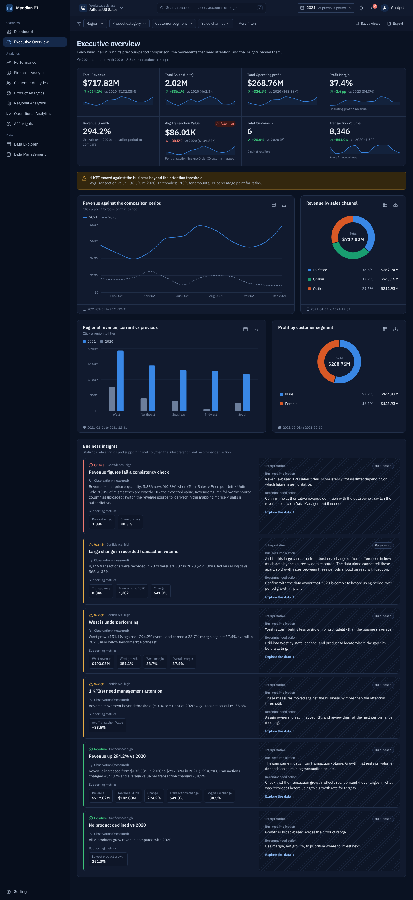
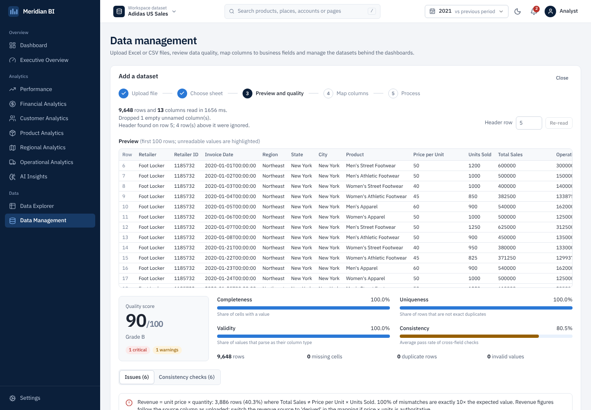

# Adidas US Sales Analytics

Two business intelligence builds on the same dataset, 9,648 Adidas US sales transactions from 2020 and 2021:

1. **[Power BI report](power-bi/)**: an 8-page report with a star-schema model, 44 DAX measures, prior-year comparisons and synced filters.
2. **[Web BI platform](web-platform/)**: a full-stack app (React, FastAPI, PostgreSQL, Docker) that ingests any Excel or CSV file, checks its quality, maps columns and serves interactive dashboards.



## What the data shows

| | 2020 | 2021 | Change |
|---|---|---|---|
| Revenue | $182.1M | $717.8M | +294% |
| Operating profit | $63.4M | $268.8M | +324% |
| Operating margin | 34.8% | 37.4% | +2.6 pp |
| Transactions | 1,302 | 8,346 | +541% |
| Avg transaction value | $139,847 | $86,008 | −38.5% |

- **Growth came from volume, not value.** Transactions rose faster than revenue while the value of each transaction fell by over a third. Some of the jump probably reflects how much activity was recorded in 2020, not demand alone.
- **West is the largest region** ($193M in 2021). **Men's Street Footwear is the top product** ($171M in 2021). Footwear is two thirds of revenue.
- **Online is the most profitable channel** (39.0% operating margin across both years, against 36.5% for Outlet and 35.8% for In-Store).
- **The revenue column needs confirming before external use.** In 3,886 of 9,648 rows (40.3%), Total Sales is exactly 10× Price per Unit × Units Sold, including every In-Store row. `Retailer ID` is not unique: the same ID is used by several different retailers. Both reports flag these rather than silently correcting them.

## Repository layout

```
power-bi/
  Adidas Sales Analytics.pbix            finished report, data included
  Adidas Sales Analytics.pbip            same report as a Power BI Project (TMDL + PBIR, Git-friendly)
  Adidas Sales Analytics.SemanticModel/  model: tables, relationships, Power Query, DAX measures
  Adidas Sales Analytics.Report/         report pages and visuals
  tools/                                 generator and schema validator for the project files
  screenshots/
web-platform/
  backend/                               FastAPI: ingestion, cleaning, validation, KPIs, insights, exports
  frontend/                              React + TypeScript + Tailwind + Recharts
  docker-compose.yml                     PostgreSQL + API + nginx
  docs/                                  OpenAPI spec and screenshots
data/
  Adidas US Sales Datasets.xlsx          source workbook
```

## Power BI report

Open `power-bi/Adidas Sales Analytics.pbix` in Power BI Desktop. The pages cover the executive overview, business performance, products, regions, retailers, financials, operations and data quality. Details of the model and measures are in the [Power BI README](power-bi/README.md).

| | |
|---|---|
|  |  |
|  |  |

## Web BI platform

Upload a workbook, review a data quality report, accept or adjust the suggested column mapping, then explore nine analysis pages (overview dashboard, executive, performance, financial, customer, product, regional, operations, AI insights) and a row-level data explorer. Every chart exports to PNG and CSV and can switch to a table view; most also cross-filter the page or drill down on click. Insights keep measured statistics separate from interpretation. The backend has 25 tests, including checks that recompute the headline KPIs and breakdown totals from the raw Excel file and compare them with the API.

```bash
cd web-platform
cp .env.example .env
docker compose up --build -d    # http://localhost:8080
```

| | |
|---|---|
|  |  |

Architecture, API reference and configuration are in the [web platform README](web-platform/README.md).

## Data

`data/Adidas US Sales Datasets.xlsx` is the publicly available Adidas US sales sample dataset, widely shared on Kaggle and data.world for analytics practice. It is used here for demonstration only. This project is not affiliated with or endorsed by adidas AG; the adidas name and logo are trademarks of their owner and appear only to label the dataset.

## Tools

Power BI Desktop (Power Query, DAX, TMDL, PBIR) · Python (pandas, NumPy, FastAPI, SQLAlchemy, Pydantic, pytest) · PostgreSQL · TypeScript, React, Tailwind CSS, Recharts · Docker, nginx, GitHub Actions
