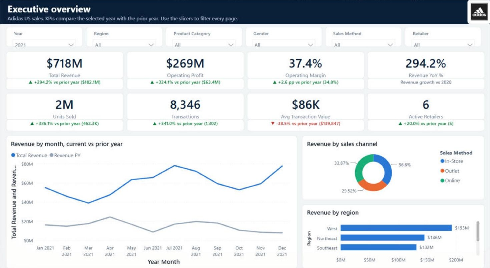
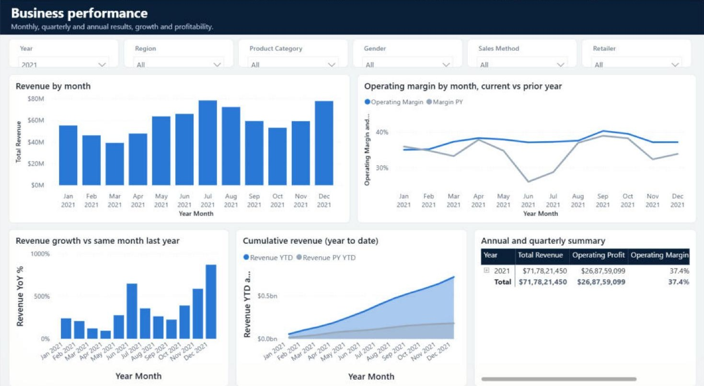
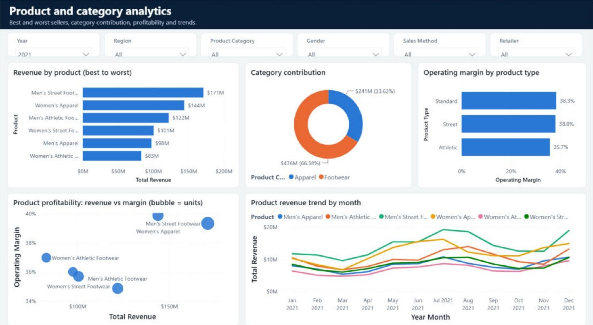
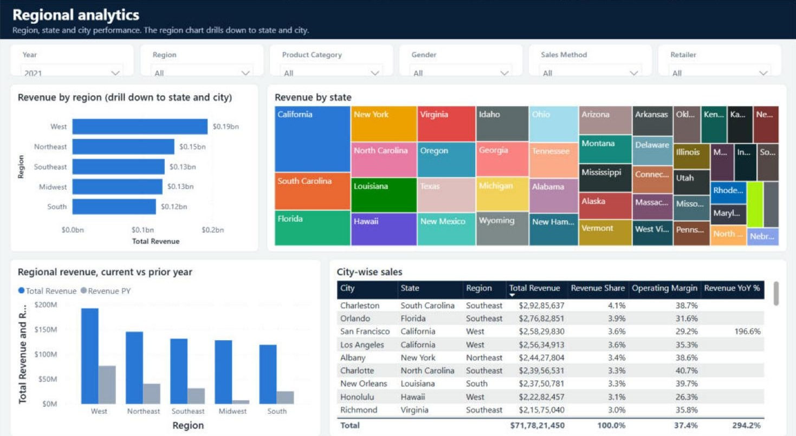
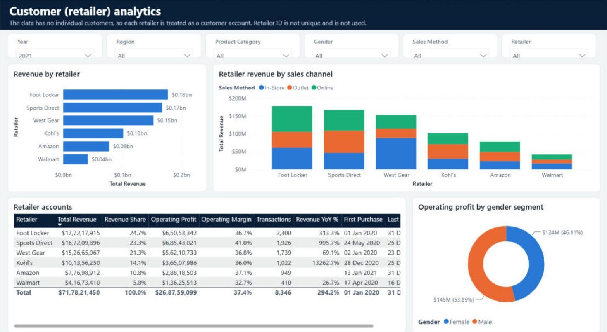
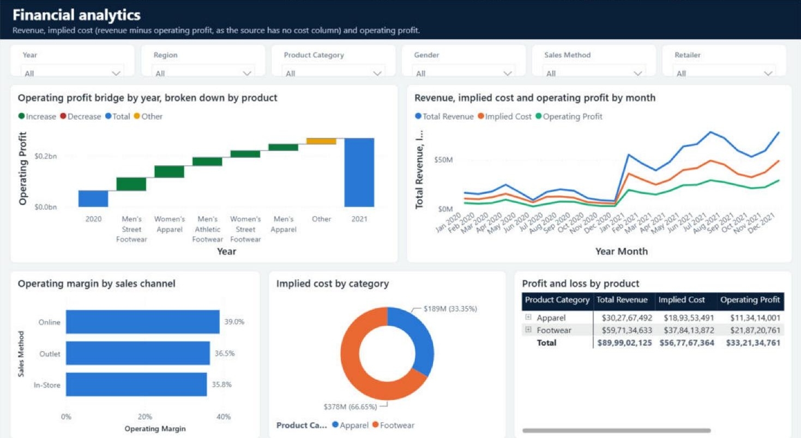
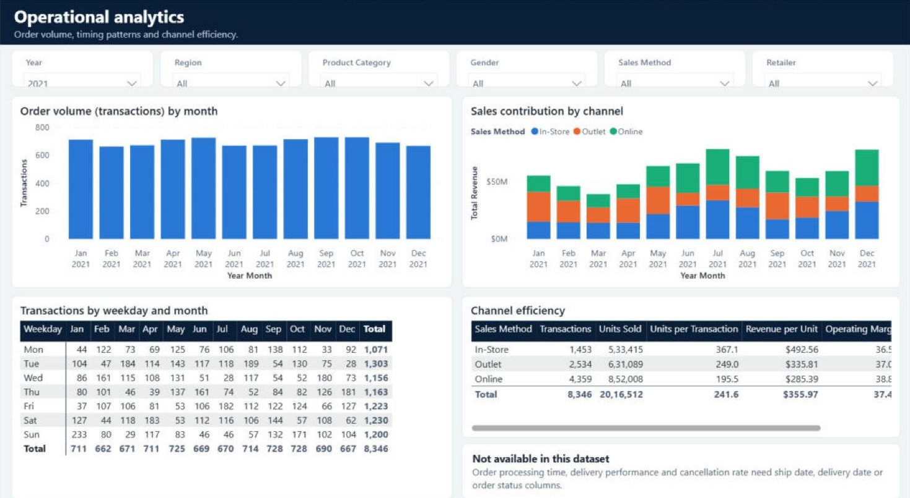
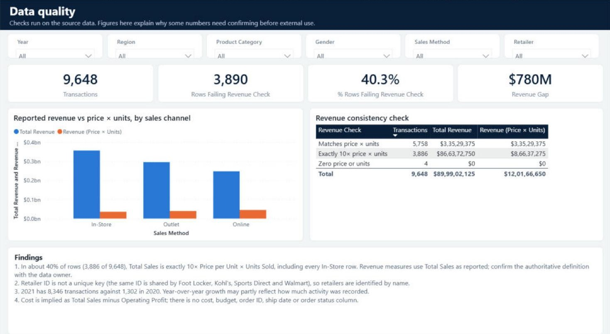

# Power BI report: Adidas US Sales Analytics

An 8-page Power BI report on 9,648 Adidas US sales transactions (2020–2021): a star-schema model, 44 DAX measures, prior-year comparisons, synced filters and a data quality page.



## Open it

| File | Use it to |
|---|---|
| `Adidas Sales Analytics.pbix` | Open the finished report with data already loaded (Power BI Desktop) |
| `Adidas Sales Analytics.pbip` | Open the same report as a Power BI Project: plain-text model (TMDL) and report (PBIR) files that diff cleanly in Git |

To refresh the data, point the `ExcelFilePath` parameter at the workbook in [`../data`](../data): **Home → Transform data → Edit parameters**, paste the full path to `Adidas US Sales Datasets.xlsx`, then **Refresh**.

## Pages

| Page | What it answers |
|---|---|
| Executive overview | Headline KPIs for the selected year with change vs prior year, monthly revenue vs prior year, channel and region split |
| Business performance | Monthly revenue, margin vs prior year, month-on-month growth, year-to-date, quarterly summary |
| Product analytics | Best and worst sellers, category share, margin by product type, revenue vs margin bubble chart, product trends |
| Regional analytics | Region → state → city drill-down, state treemap, region vs prior year, city table |
| Customer (retailer) analytics | Revenue and channel mix per retailer, account table with first and last purchase |
| Financial analytics | Operating profit bridge 2020 → 2021 by product, revenue vs implied cost vs profit, margin by channel, P&L matrix |
| Operational analytics | Transactions by month and weekday, channel efficiency (units per transaction, revenue per unit) |
| Data quality | Revenue consistency checks and the findings that limit how far the figures can be trusted |

Six dropdown slicers (Year, Region, Product Category, Gender, Sales Method, Retailer) sit on every page and are synced, so a selection carries across pages. The Financial and Data quality pages keep their own Year selection so they can show both years at once.

| | |
|---|---|
|  |  |
|  |  |
|  |  |
|  | |

## Data model

```
                 Calendar (DAX)
                      │ Date
Product ── Sales (fact, 9,648 rows) ── Retailer
                 │            │
           Geography    Sales Method
           (City Key)
```

- **Sales** is loaded with Power Query from the `Cleaned_Table` sheet: typed and trimmed columns plus derived `Price x Units`, `Implied Cost` (Total Sales − Operating Profit), a `Revenue Check` classification and a `City Key` (city + state, because city names repeat across states).
- **Product, Retailer, Geography, Sales Method** are dimension tables built from the fact table with `Table.Distinct`. Single-direction, many-to-one relationships.
- **Calendar** is a DAX table covering the years in the data, with sort-by columns for month and weekday names. Auto date/time is off.
- **_Measures** holds every measure, grouped in display folders:

| Folder | Examples |
|---|---|
| 1. Core (11) | Total Revenue, Operating Profit, Operating Margin, Implied Cost, Transactions, Avg Transaction Value, Revenue Share |
| 2. Prior year (12) | Revenue PY, Revenue YoY %, Margin Change (pp), Revenue YTD, Revenue PY YTD |
| 3. KPI labels (15) | Text such as `▲ +294.2% vs prior year ($182.1M)` and the green / red / grey colour measures behind it |
| 4. Retailers (2) | First Purchase, Last Purchase (ignore the date filter) |
| 5. Data quality (4) | Revenue (Price × Units), Revenue Gap, Rows Failing Revenue Check, % Rows Failing |

Prior-year measures return a value only when one year is selected, so a KPI never compares a two-year total with a one-year total. With several years selected, the label reads "Select one year to compare".

```dax
Revenue PY =
IF (
    COUNTROWS ( VALUES ( 'Calendar'[Year] ) ) = 1,
    CALCULATE ( [Total Revenue], SAMEPERIODLASTYEAR ( 'Calendar'[Date] ) )
)
```

## How it was built

The project was generated as code. [`tools/build_pbip.py`](tools/build_pbip.py) writes the TMDL model and PBIR report definition, and [`tools/validate.py`](tools/validate.py) checks every report JSON file against Microsoft's published schemas. The project was then opened in Power BI Desktop, refreshed, and saved as the `.pbix`. The header logo was added afterwards in Desktop, and the report files in this folder are the ones saved by Desktop.

```bash
python tools/build_pbip.py out "C:\path\to\Adidas US Sales Datasets.xlsx"
```
