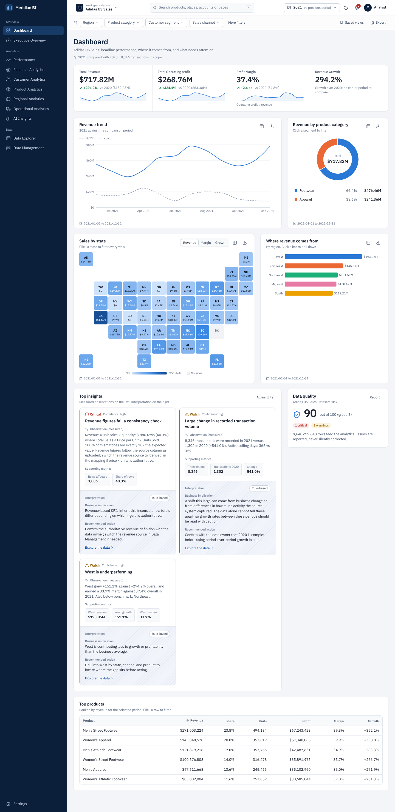
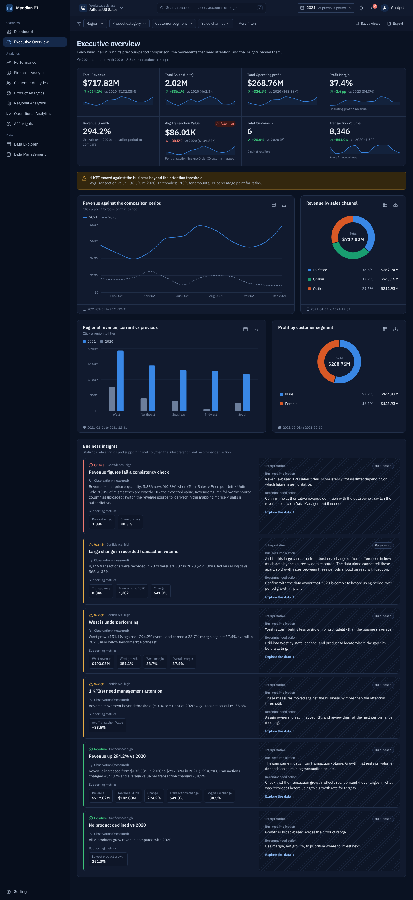
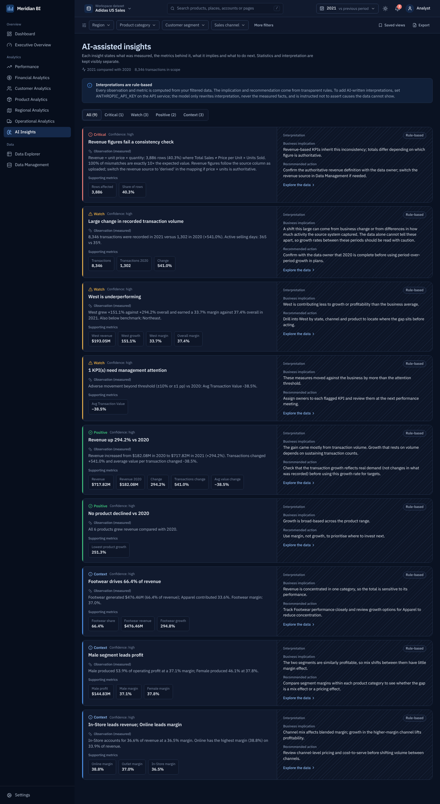
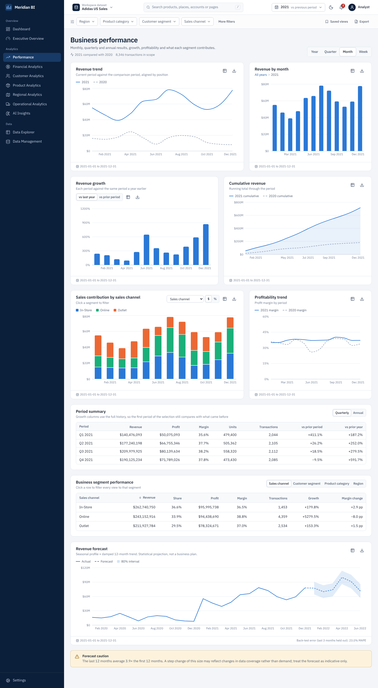
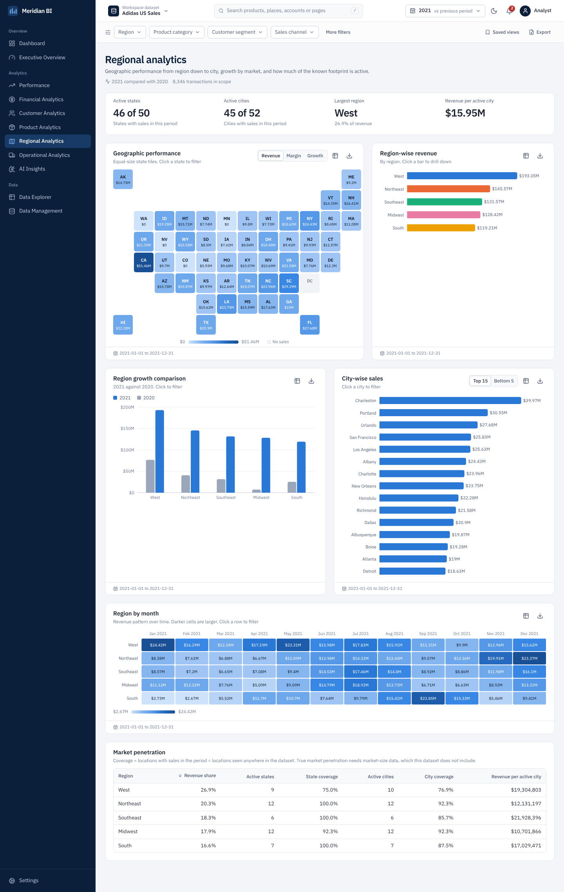
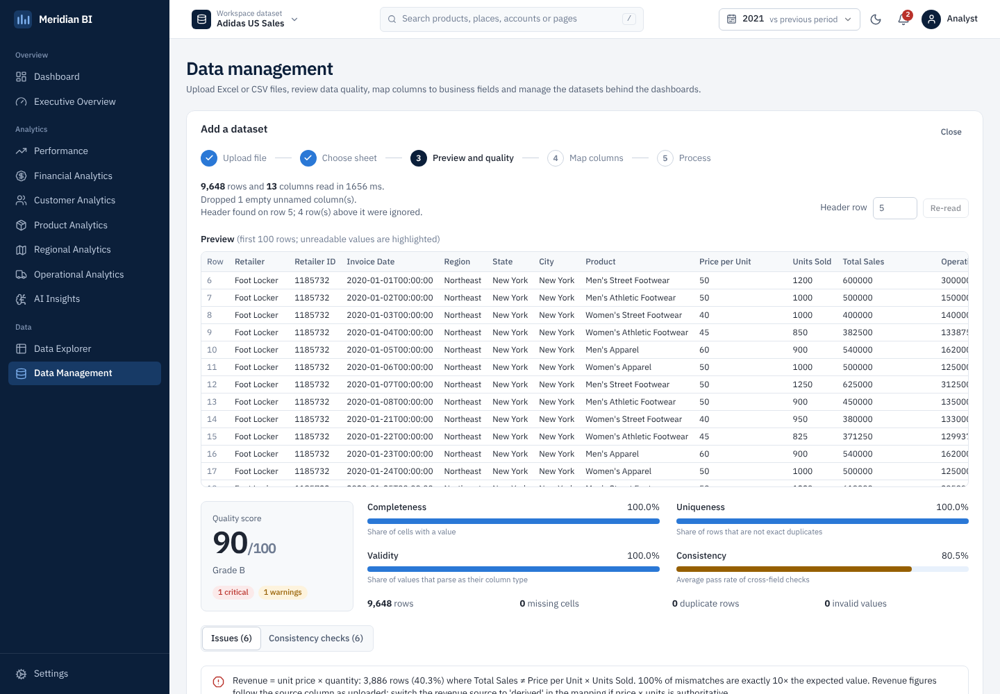
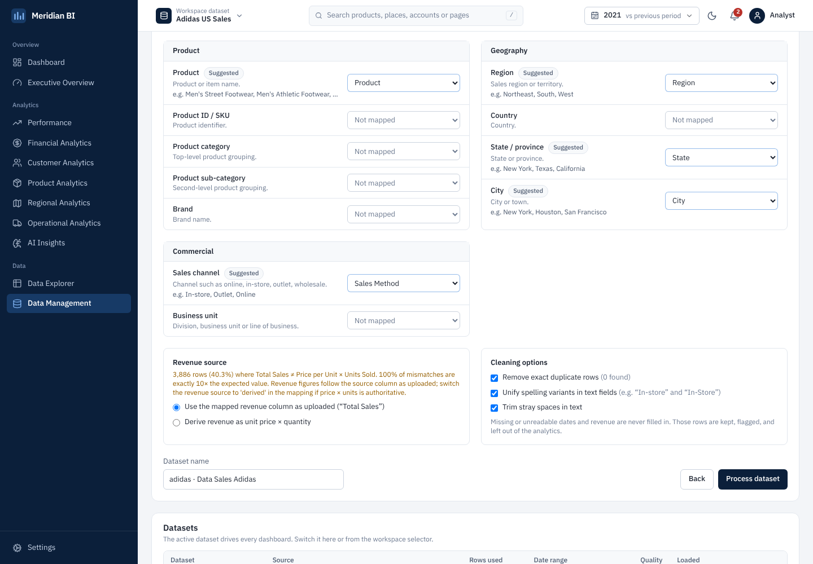

# Meridian BI

An interactive business intelligence platform. Upload an Excel workbook or CSV, inspect a data quality report, map your columns to business fields, and explore executive KPIs, performance, financial, customer, product, regional and operational analytics. Every chart cross-filters, drills down and exports. An insights module separates measured statistics from interpretation.

Built and verified against the **Adidas US Sales** workbook (9,648 transactions, 2020–2021), but nothing is hard-coded to that schema: column mapping is done per upload.



| | |
|---|---|
|  |  |
|  |  |
|  |  |

---

## Quick start (Docker)

```bash
cp .env.example .env          # set POSTGRES_PASSWORD (and optionally ANTHROPIC_API_KEY)
docker compose up --build -d
open http://localhost:8080    # interactive API docs: http://localhost:8080/api/docs
```

Then go to **Data Management → Upload a file**. Drop `data/Adidas US Sales Datasets.xlsx` (in the repository root), choose the `Cleaned_Table` sheet (pre-selected as recommended), review the quality report, accept the suggested mapping, and click **Process dataset**.

Services: `db` (PostgreSQL 16), `api` (FastAPI, 2 workers), `web` (nginx serving the React build and proxying `/api`). Data and uploads persist in named volumes.

## Local development

```bash
# API
cd backend
python -m venv .venv && source .venv/bin/activate
pip install -r requirements-dev.txt
export DATABASE_URL=postgresql+psycopg://bi:bi@localhost:5432/bi
uvicorn app.main:app --reload --port 8000        # Swagger UI at http://localhost:8000/api/docs

# Frontend (separate shell) — Vite proxies /api to :8000
cd frontend
npm install
npm run dev                                      # http://localhost:5173
npm run typecheck
```

---

## Architecture

```
Excel / CSV upload ─► File validation ─► Ingestion engine ─► Cleaning & transformation ─► Validation layer
   (React drop zone)   ingestion/          ingestion/reader     processing/cleaning,         processing/validation
                       file_validation     (sheets, headers,    processing/transform         (cross-field checks,
                                           encodings)           (mapping → canonical)        post-load reconciliation)
        │
        ▼
PostgreSQL (datasets, fact_records, uploads, filter_presets) ─► Business logic & KPIs ─► FastAPI ─► React ─► Dashboard
  models.py, services/datasets.py (COPY bulk load)               analytics/*, insights/*    api/routes   src/pages/*
```

Each layer is its own module with no upward dependencies, so any layer can be replaced (for example, swapping the pandas analytics engine for SQL views) without touching the others.

**Storage model.** Uploads can have any schema. After mapping, rows are normalised into one canonical, typed fact table (`fact_records`: dates, numeric measures, text dimensions). The original cleaned row is kept as JSONB in `raw` for record-level drill-through and audit. Analytics load the canonical columns for a dataset into an in-process LRU cache (per worker) and compute with pandas. The Data Explorer and exports query PostgreSQL directly with server-side filtering, search, sorting and paging.

### Repository layout

```
backend/
  app/
    ingestion/     file_validation, reader (multi-sheet, header detection, CSV sniffing), profiler, quality, mapping
    processing/    cleaning (numbers, dates, currency, spelling variants, duplicates, outliers), transform, validation
    analytics/     common (filters, periods, measures), kpis, performance, breakdowns (product/regional/customer/
                   financial/operations), forecast, capabilities
    insights/      engine (statistical observations + rule interpretation), narrator (optional AI interpretation)
    services/      datasets (pipeline orchestration, bulk load), records (explorer, exports, reports)
    api/           routes, deps
  tests/           25 tests: unit, API integration, Adidas verification, AI-layer contract
frontend/
  src/
    components/    layout (sidebar, top bar, filter bar), charts (ChartCard, Recharts charts, heat map, US tile map,
                   drill-down), kpi, insights, data (tables, quality report), ui
    pages/         Dashboard, Executive, Performance, Financial, Customers, Products, Regional, Operations,
                   Insights, Explorer, DataManagement, Settings
    state/         global filters, dataset, theme, entity colours
  nginx/           reverse proxy + security headers
e2e/ui-check.mjs   Playwright end-to-end check (33 assertions)
docs/openapi.json  generated API specification
```

---

## How the platform treats data

- **Nothing is invented.** Missing or unreadable dates and revenue are never filled in. Those rows are stored, flagged with the reason, excluded from analytics, and visible in the Data Explorer with *Include excluded rows*. Periods with no transactions appear as gaps, not zeros.
- **Derived values are labelled.** If there is no cost column but profit exists, cost is shown everywhere as *Implied cost (revenue − profit)*. Revenue can be derived from price × quantity only when the user chooses it.
- **Unsupported metrics say so.** Each module checks which business fields are mapped. Order processing time, delivery, cancellations, budget vs actual, net profit and customer lifetime value appear only when the data supports them; otherwise a panel names the missing field.
- **Statistics and interpretation are separate.** Each insight has an *Observation* and *Supporting metrics* (computed deterministically) and, in a visually distinct hatched pane, a *Business implication* and *Recommended action*, labelled **Rule-based** or **AI-generated**. Rules never assert causes; the AI prompt forbids it and may only rewrite the interpretation fields.
- **Consistency is checked twice.** Before load: revenue vs price × quantity, margin vs profit ÷ revenue, profit ≤ revenue, sign checks, date plausibility, ID-to-name key conflicts. After load, stored row count, revenue and profit totals are reconciled with the processed file, and a mismatch aborts the load.

### What the Adidas workbook supports

| Module | Supported | Notes |
|---|---|---|
| Executive KPIs | All 8 | AOV is per transaction line because there is no order ID; customers = retailers |
| Performance, growth, forecast | Yes | Forecast warns about the 2020→2021 level shift |
| Financial | Revenue, implied cost, operating profit, margin, waterfalls | No net profit, no budget column |
| Customers | Yes, at retailer (account) level | 6 accounts, so CLV modelling is disabled and lifetime revenue is shown per account |
| Products, regional | Yes | 6 products, 2 categories, 5 regions, 50 states, 52 cities |
| Operations | Volume, units per transaction, weekday pattern, channel efficiency | No ship/delivery dates or order status |

### Findings in the Adidas data (surfaced by the quality report and insights)

1. **Revenue inconsistency: critical.** In 3,886 of 9,648 rows (40.3%), `Total Sales` is exactly **10×** `Price per Unit × Units Sold`, including every In-Store row. Dashboards use `Total Sales` as uploaded, and the mapping screen offers *Derive revenue as unit price × quantity* if that is the authoritative definition. Confirm with the data owner before using revenue figures externally.
2. **`Retailer ID` is not a key.** The same ID is shared by different retailers (e.g. 1128299 → Foot Locker, Kohl's, Sports Direct, Walmart), so customers are identified by retailer name instead.
3. **Coverage shift.** 2021 has 8,346 transactions against 1,302 in 2020 (+541%). The +294% revenue growth is driven by volume, while value per transaction fell 38.5%. Growth between these years may reflect what was recorded rather than demand.
4. The `Data Sales Adidas` sheet has title rows above the header (detected on row 5) and an empty first column (dropped). `Fact` (638k key rows) and the lookup sheets are dimension tables, not transaction data.

---

## API

28 REST endpoints; the full specification is in [`docs/openapi.json`](docs/openapi.json) and served live at `/api/docs` (Swagger UI) and `/api/redoc`.

| Area | Endpoints |
|---|---|
| System | `GET /api/health`, `GET /api/system/info` |
| Ingestion | `POST /api/uploads` (multipart), `GET /api/uploads/{id}/analysis?sheet=&header_row=` (preview, profiles, quality report, mapping suggestion) |
| Datasets | `POST /api/datasets` (process with mapping + options), `GET /api/datasets`, `GET/PATCH/DELETE /api/datasets/{id}`, `GET …/quality`, `GET …/capabilities`, `GET …/filter-options`, `GET …/search?q=` |
| Analytics | `POST /api/datasets/{id}/analytics/{overview, kpis, performance, products, regional, customers, financial, operations, forecast, insights, breakdown, timeseries}` with body `{ "filters": {…}, "granularity", "dimension", "split_by", … }` |
| Records | `POST …/records/query` (page, sort, search, columns), `GET …/records/{record_id}`, `POST …/export` (CSV/XLSX), `POST …/report` (Excel or printable HTML) |
| Saved views | `GET/POST /api/presets`, `DELETE /api/presets/{id}` |

Filters (shared by every analytics, records, export and report call):

```json
{ "start_date": "2021-01-01", "end_date": "2021-12-31", "region": ["West"], "category": [], "customer_segment": [],
  "business_unit": [], "channel": ["Online"], "state": [], "city": [], "product": [], "customer": [],
  "comparison": "previous_period" }
```

`comparison` is `previous_period` (equal-length window before; calendar-aware for months, quarters and years), `previous_year`, or `none`.

---

## Configuration

| Variable | Default | Purpose |
|---|---|---|
| `DATABASE_URL` | `postgresql+psycopg://bi:bi@localhost:5432/bi` | SQLAlchemy URL (SQLite works for tests) |
| `UPLOAD_DIR` | `./data/uploads` | Uploaded files and parsed-sheet cache |
| `MAX_UPLOAD_MB` | `100` | Upload limit (keep nginx `client_max_body_size` above it) |
| `PROFILE_ROW_LIMIT` | `250000` | Rows profiled during preview (processing always reads the full sheet) |
| `CORS_ORIGINS` | `http://localhost:5173,http://localhost:8080` | Only needed for cross-origin frontends |
| `WEB_CONCURRENCY` | `2` | API worker processes |
| `FRAME_CACHE_SIZE` | `8` | Datasets kept in each worker's analytics cache |
| `ANTHROPIC_API_KEY` | empty | Enables AI-written interpretations; empty = rule-based |
| `INSIGHTS_LLM_MODEL` | `claude-sonnet-5-5` | Model used for interpretations |
| `API_UPSTREAM` (web) | `api:8000` | Where nginx proxies `/api` |

## Testing

```bash
cd backend
TEST_DATABASE_URL=postgresql+psycopg://bi:bi@localhost:5432/bi_test \
ADIDAS_XLSX="../../data/Adidas US Sales Datasets.xlsx" pytest   # from web-platform/backend
```

The Adidas tests recompute every KPI independently from the raw Excel file with pandas and compare it with the API. They also reconcile regional and monthly breakdowns to totals under combined filters, and assert the data quality findings above. Without `ADIDAS_XLSX` those tests are skipped. With a stack running, `node e2e/ui-check.mjs` drives the UI end to end. It covers the upload wizard on the messy sheet, cross-filtering, drill-down and breadcrumbs, date presets, multi-select filters, saved views, global search, the Data Explorer and record drawer, CSV/XLSX/PNG/report downloads, and a runtime-error sweep of every page.

## Deploying to a cloud

- Use a managed PostgreSQL and set `DATABASE_URL`. Tables are created at startup under an advisory lock, so several replicas can start together.
- Put uploads on a persistent volume, or replace `save_upload` with object storage. Parsed sheets are cached next to the upload.
- The analytics cache is per process. Scale API replicas horizontally behind the `web` proxy or your load balancer. For tens of millions of rows, move the heavy aggregations into SQL or materialised views behind the same `analytics/*` functions.
- **Authentication is not included.** Place the app behind your SSO or identity-aware proxy before exposing it.

## Verification status

Verified in the build environment: backend tests (25/25) on PostgreSQL 16 and SQLite; a live stack on PostgreSQL with the Adidas workbook; end-to-end UI checks (33/33); strict TypeScript type-check; light, dark and 390px phone layouts with no horizontal overflow; the Compose file validated with `docker compose config`.

**Not executed in the build environment**, because it had no Docker daemon and no access to the npm and PyPI registries: building the Docker images, `npm install` / `vite build`, and an `nginx -t` lint. The frontend was bundled and tested with an equivalent esbuild + Tailwind CSS 4 pipeline from the same sources and pinned dependency versions. The CI workflow in the repository's `.github/workflows/ci.yml` runs all three on GitHub (start it from the Actions tab). Run `docker compose up --build` once and report anything that differs.

The original specification was truncated at section 11 ("Backend API design"), so the API above was designed to cover sections 1–10.
